  

 

  

### `// 01` &nbsp; ENGINEERING AT SCALE

I'm a **Software Development Engineer at Flipkart** building backend systems where reliability, speed, and data matter. I work across **Java, Dropwizard, Spring Boot, Kafka, SQL, and Redis** — and explore what happens when distributed systems meet **LLMs, RAG, and AI agents**.

<table><tr>
<td align="center" width="25%"><h2>~4,400</h2>peak requests/sec</td>
<td align="center" width="25%"><h2>70×</h2>lower P99 API latency</td>
<td align="center" width="25%"><h2>20M+</h2>seller records migrated</td>
<td align="center" width="25%"><h2>5</h2>national hackathon wins</td>
</tr></table>

Highlights from work at Flipkart. P99 latency improved from 5 seconds to 60 milliseconds; records were migrated without downtime.

### `// 02` &nbsp; WHAT I WORK ON

**⚡ High-throughput backends** — Event-driven services and data pipelines with Java, Dropwizard, Kafka, Debezium, and Flink. Built for real-world traffic and resilient integrations.

**🧠 Applied AI** — LLM integration, retrieval-augmented generation (RAG), multimodal question answering, and conversational agents. Connecting models to useful information and workflows.

**🛠️ Platforms that last** — Data migration, caching, asynchronous I/O, circuit breakers, and observability. From production systems to the tools that keep them healthy.

### `// 03` &nbsp; FEATURED PROJECTS

<table><tr><td width="50%" valign="top">
<h3>◈ Multimodal QA + Web Agent</h3>

Question answering across documents and video, with relevant images and a web navigation agent.

<code>RAG</code> <code>PYTHON</code> <code>LANGCHAIN</code>  
<a href="https://github.com/prathameshparit/Multimodal_QA_System_with_Web_Agent"><strong>EXPLORE ↗</strong></a>
</td><td width="50%" valign="top">
<h3>◉ Multi-Agent Conversational Chat</h3>

Specialized conversational agents that collect and structure information.

<code>AUTOGEN</code> <code>LLMs</code> <code>LANGCHAIN</code>  
<a href="https://github.com/prathameshparit/Multi_Agent_Conversational_Chat"><strong>EXPLORE ↗</strong></a>
</td></tr><tr><td width="50%" valign="top">
<h3>✦ Conversational Fashion AI</h3>

An AI fashion assistant for personalized outfit generation and virtual try-ons.

<code>STABLE DIFFUSION</code> <code>CONTROLNET</code> <code>LLMs</code>  
<a href="https://github.com/prathameshparit/Conversational_Fashion_Outfit_Generator"><strong>EXPLORE ↗</strong></a>
</td><td width="50%" valign="top">
<h3>⬡ Production Engineering</h3>

At Flipkart: unified master data, modernized document storage, and migrated production workloads without downtime.

<code>JAVA</code> <code>KAFKA</code> <code>DATA PLATFORMS</code>
</td></tr></table>

### `// 04` &nbsp; TECH STACK

**Backend:** Java · Dropwizard · Spring Boot · gRPC · REST APIs  
**Data & streaming:** Kafka · Debezium · Flink · SQL · Redis · Aerospike  
**AI:** LLMs · RAG · LangChain · AutoGen · model evaluation · computer vision  
**Platform:** Docker · Kubernetes · GCP · AWS · Prometheus · Grafana

### `// 05` &nbsp; ACHIEVEMENTS

🏆 **Five national hackathon wins**, including Flipkart Grid 5.0 and the Microsoft Azure Hackathon.  
🎓 **B.E. in Artificial Intelligence and Data Science**, with honours in AI and ML.  
🔥 **Flipkart Instant Karma Award**, 2025 and 2026.

 
<strong>BUILD AT SCALE. STAY CURIOUS. KEEP SHIPPING.</strong>

